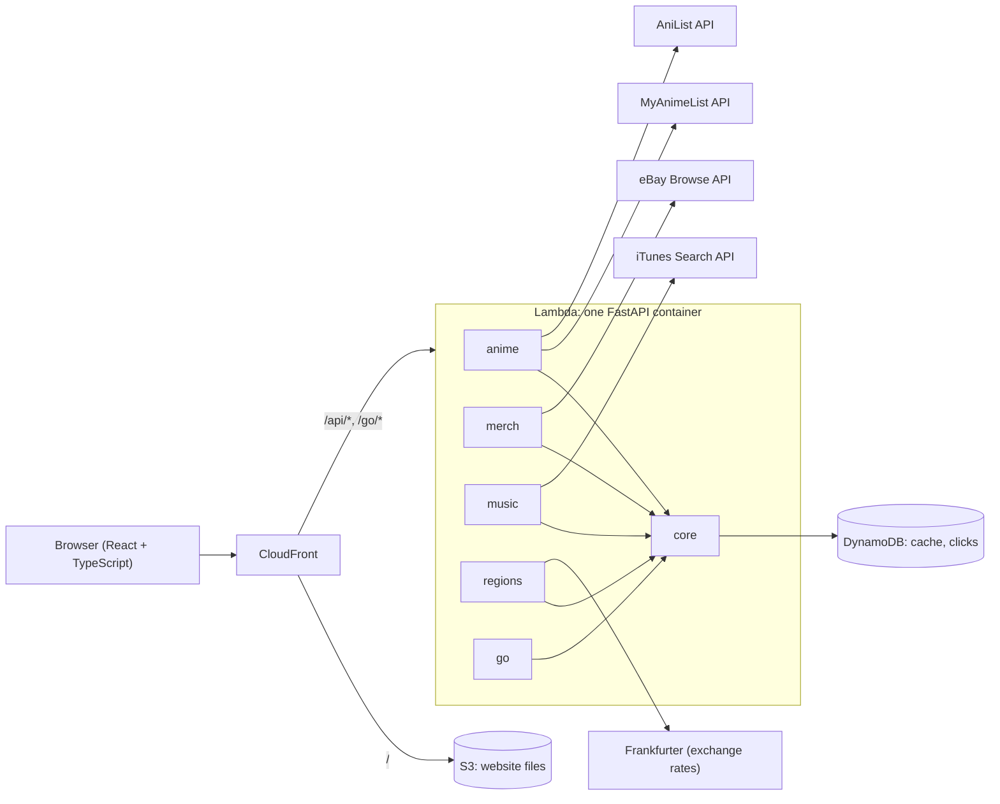

# OshiLoot


***Find treasures for your oshi***

[](https://github.com/Runus01/oshiloot/actions/workflows/ci.yml)

OshiLoot reads your MyAnimeList, lines up your anime by the scores you gave them, and shows
where to buy official and second-hand merch that ships to your country. Pick a favourite
character to see merch of just them, or play an anime's opening and ending songs and find
the CD or download.

**Try it:** _link coming soon_

---

## Contents

- [What you can do](#what-you-can-do)
- [Using OshiLoot](#using-oshiloot)
- [Run it on your own computer](#run-it-on-your-own-computer)
- [Troubleshooting](#troubleshooting)
- [How it's built](#how-its-built)
- [Host it online with AWS](#host-it-online-with-aws)
- [Data sources, terms and credits](#data-sources-terms-and-credits)

## What you can do

- **See your list by score.** Enter a MyAnimeList username, or sign in with MyAnimeList if
  your list is private. Completed and Watching anime are grouped by your score, 10 first.
- **Search any anime**, in English, romaji or Japanese.
- **Find merch that ships to you.** Live eBay listings, plus searches on CDJapan, AmiAmi,
  HobbyLink Japan, Mercari (via Buyee), Carousell and Hakken!, filtered to stores that
  deliver to your country, with prices converted to your currency.
- **Visit shops in person.** In Singapore: La Tendo, Otaku House and Books Kinokuniya, with
  directions to each outlet.
- **Shop for your oshi.** Open any character to see merch of just them, and the group goods
  they're part of.
- **Hear the theme songs.** Rest your cursor on an opening or ending to hear a 30-second
  preview, then find the single, the album or a download.

## Using OshiLoot

### 1. Choose your country

The first time you visit, OshiLoot asks **Where should merch ship to?** Your choice decides
which stores you see, the currency prices are converted to, and the shipping shown. Change
it any time with the **Shipping to …** button at the top right.

17 countries are supported, including Singapore, Malaysia, the Philippines, Japan, the US
and the UK.

### 2. Load your list

Type your MyAnimeList username and press **Load my list**. This works for public lists.

If your list is private, press **Sign in with MyAnimeList**. You sign in on MyAnimeList's
own website, and OshiLoot never sees your password. Your list then loads automatically
whenever you come back. **Sign out** is next to your name.

Your anime appear on shelves by score, from 10 down. Switch between **Completed** and
**Watching** with the tabs.

### 3. Or search for any anime

Under **Or search any anime**, type a title in English, romaji or Japanese, such as
*Frieren*, *Bocchi the Rock!* or *葬送のフリーレン*.

### 4. An anime's page

Open any anime to see, from top to bottom:

- **Characters**, main roles first. **Show more characters** loads the rest.
- **Official stores** and **Second-hand**: live listings with prices and shipping where a
  store provides them, then a search link for every store that ships to you.
- **Shops in [your country]**, with addresses and a **Directions** link for each outlet,
  and a search of the shop's online store where it has one. Singapore only, for now.
- **Theme songs**, the openings and endings.

Prices show in the store's currency with an approximate price in yours, for example
"$27.00 ≈ SGD 36.25". Check the store's own page before you pay.

### 5. Your oshi's page

Click a character to see their merch, split into:

- **Just [name]:** listings that name only them.
- **[name] with others:** sets, posters and group goods that include them, each labelled
  with who else is on it.
- **Search stores for [name]:** every store's own search, for more than the live listings.

Live listings come from eBay, so this split needs eBay API keys (see
[Optional settings](#optional-settings)). Without them, the store searches still work.

### 6. Theme songs

- **Hover** over a song for a moment to hear Apple's 30-second preview. Move away and it
  fades out. On a phone, press the song's **play button** instead.
- **Click the title** to open the song's page, with:
  - the preview and its price in your country's Apple store
  - the single and the albums the song is on
  - **CDs and vinyl** searches on CDJapan and Tower Records Japan

Browsers only play sound after you've clicked somewhere on the page. If hovering does
nothing, click anywhere once and try again. Untick **Play previews on hover** if you'd
rather hover in silence.

### Your privacy

- Your list is never stored on the server. It's shown to you and kept only in your
  browser tab until you close it.
- Signing in keeps your MyAnimeList session in an encrypted cookie in your own browser,
  not in a database. Signing out deletes it.
- When you click through to a store, OshiLoot records only the store, the anime and the
  country, nothing about you.

## Run it on your own computer

This runs the whole site locally: the Python backend on port 8080 and the website on port
5173. It takes about 15 minutes the first time.

### What you need

| Tool | Version | Get it |
| --- | --- | --- |
| Git | any recent | [git-scm.com](https://git-scm.com/downloads) |
| Python | 3.12 or newer | [python.org](https://www.python.org/downloads/), or `winget install Python.Python.3.12` |
| Node.js | 22 or newer | [nodejs.org](https://nodejs.org/) (the LTS version), or `winget install OpenJS.NodeJS.LTS` |
| A MyAnimeList account | | [myanimelist.net](https://myanimelist.net/register.php) |

Docker isn't needed. Commands below are for Windows PowerShell; macOS and Linux
differences are noted.

### 1. Get the code

```powershell
git clone https://github.com/Runus01/oshiloot.git
cd oshiloot
```

### 2. Get a MyAnimeList API key

1. Go to [myanimelist.net/apiconfig](https://myanimelist.net/apiconfig) and press
   **Create ID**.
2. Fill in the form:
   - **App Type:** `web`
   - **App Redirect URL:** `http://localhost:5173/api/anime/auth/callback`, exactly, with
     no slash at the end
   - **Homepage URL:** this repo's address, or your own
   - **Commercial / Non-Commercial:** `non-commercial`
3. Copy the **Client ID**, and the **Client Secret** if you want sign-in to work.

### 3. Add your settings

```powershell
Copy-Item .env.example .env       # macOS/Linux: cp .env.example .env
```

Open `.env` and fill in:

```dotenv
MAL_CLIENT_ID=your-client-id
MAL_CLIENT_SECRET=your-client-secret   # optional: shows the "Sign in" button
```

Everything else in `.env` is optional and can stay as it is. `.env` is ignored by Git, so
your keys stay on your computer.

### 4. Start the backend (first terminal)

```powershell
cd backend
py -3.12 -m venv .venv             # macOS/Linux: python3.12 -m venv .venv
.\.venv\Scripts\Activate.ps1       # macOS/Linux: source .venv/bin/activate
pip install -r requirements-dev.txt
uvicorn app.main:app --reload --port 8080
```

Leave it running. When it says `Application startup complete`, the API is up;
http://localhost:8080/api/docs lists every endpoint.

### 5. Start the website (second terminal)

```powershell
cd frontend
npm install
npm run dev
```

### 6. Open http://localhost:5173

Use port **5173**, not 8080. The website passes `/api` requests to the backend, which keeps
the sign-in cookie working.

**Next time,** skip the installs: run `.\.venv\Scripts\Activate.ps1` then the `uvicorn`
line in `backend`, and `npm run dev` in `frontend`. Stop either with Ctrl+C.

### Optional settings

All of these go in `.env`. Without them the site still works, with plain store links.

| Setting | What it adds | Where to get it |
| --- | --- | --- |
| `EBAY_CLIENT_ID`, `EBAY_CLIENT_SECRET` | Live eBay listings with prices and shipping, and the solo/group split on character pages | [developer.ebay.com](https://developer.ebay.com): Application Keys, Production keyset (App ID and Cert ID) |
| `EBAY_CAMPAIGN_ID` | eBay commission on clicks | [eBay Partner Network](https://partnernetwork.ebay.com): your campaign's ID |
| `CDJAPAN_AFFILIATE_TEMPLATE` | CDJapan commission | CDJapan's affiliate programme: a link with `{path}` where the page goes |
| `APPLE_AFFILIATE_TOKEN` | Apple Music and iTunes commission | [Apple Performance Partners](https://performance-partners.apple.com): your Partner Token |

Restart the backend after changing `.env`.

### Optional: run the backend in Docker

If you have Docker Desktop, this replaces step 4. It runs the same container image the live
site uses, with a local database:

```powershell
docker compose up --build
```

### Checks

```powershell
# in backend/, with the virtual environment active
ruff check . ; ruff format --check . ; lint-imports ; pytest

# in frontend/
npm run typecheck ; npm test ; npm run build
```

GitHub runs these on every pull request.

## Troubleshooting

| What you see | What to do |
| --- | --- |
| `No suitable Python runtime found` after `py -3.12` | Python 3.12 isn't installed. Install it from python.org, or run `winget install Python.Python.3.12`, then open a new terminal. |
| `running scripts is disabled on this system` when activating | Run `Set-ExecutionPolicy -Scope CurrentUser RemoteSigned` once, then try again. |
| `'vite' is not recognized` | Run `npm install` in `frontend` first. If it still fails, check `node --version` says 22 or newer. |
| "No public list found for that username" | Check the spelling. If the list is private, use **Sign in with MyAnimeList** instead. |
| A browser **username and password box** pops up on MyAnimeList | Don't type into it: it means your MyAnimeList app's **App Redirect URL** doesn't match. Set it to exactly `http://localhost:5173/api/anime/auth/callback`. |
| No **Sign in with MyAnimeList** button | Add `MAL_CLIENT_SECRET` to `.env` and restart the backend. |
| "MyAnimeList isn't configured on this server" | Add `MAL_CLIENT_ID` to `.env` and restart the backend. |
| "Character info is busy right now" | AniList allows 30 requests a minute. Wait a minute and reload. |
| Hovering over a song plays nothing | Click anywhere on the page once; browsers block sound until you do. |
| `429 Too Many Requests ... Data limit exceeded` building Docker | Amazon's public image registry is limiting your network. Run the backend without Docker (step 4), or sign in first: `aws ecr-public get-login-password --region us-east-1 \| docker login --username AWS --password-stdin public.ecr.aws`. |
| `address already in use` | Something else is on port 8080 or 5173. Close the other terminal running OshiLoot, or restart your computer. |

## How it's built

| Part | Built with |
| --- | --- |
| Website | React 19, TypeScript, Vite |
| Backend | Python 3.12, FastAPI, one container on AWS Lambda |
| Hosting | CloudFront, S3, DynamoDB, all set up with AWS CDK (TypeScript) |
| CI/CD | GitHub Actions, signing in to AWS with OIDC, so no AWS keys are stored in GitHub |

The backend is a **modular monolith**: one app with five modules that never import each
other, checked on every pull request by [import-linter](https://import-linter.readthedocs.io).



| Module | Handles |
| --- | --- |
| `anime` | Lists (public, or private after signing in), search, anime details and theme songs from MyAnimeList; characters from AniList |
| `merch` | Store and shop catalogue (`stores.yaml`), live store searches with a deadline per store, sorting a character's listings into solo and group items |
| `music` | A theme song in the user's Apple store, plus CD and vinyl shops |
| `regions` | Countries, currencies and daily exchange rates |
| `go` | Store links: checks the signed link, records the click, redirects |
| `core` | Settings, cache, shared HTTP client, link signing, request logs |

Design decisions are written up in `docs/adr/`:
[one app instead of microservices](docs/adr/0001-modular-monolith.md),
[sign-in without a database](docs/adr/0002-sign-in-session-in-cookie.md), and
[where character and music data come from](docs/adr/0003-characters-and-theme-songs.md).

```text
backend/     FastAPI app, tests, Dockerfile
frontend/    React website
infra/       AWS CDK: the OshiLootBase and OshiLootApp stacks
docs/adr/    design decisions
.github/     CI, deploy and Dependabot settings
```

**Adding a store:** add it to `backend/app/merch/stores.yaml` with its search URL (`{q}`
marks the search term). Shops to visit in person go under `shops:`, by country code. CD and
vinyl stores go in `backend/app/music/stores.yaml`.

## Host it online with AWS

Set this up once; after that, every merge to `main` deploys itself. Docker isn't needed on
your computer, because GitHub Actions builds the container. It's designed to fit AWS's free
allowances. The only regular cost is a few cents a month for storing container images.

1. **AWS account.** Create one at [aws.amazon.com](https://aws.amazon.com) and choose the
   **Paid plan**. It gets the same sign-up credits, but unlike the Free plan, the account
   doesn't close after six months. Turn on MFA and add a $1 budget alert. Then install the
   AWS CLI (version 2.32 or newer) and sign in:

   ```powershell
   aws login --profile oshiloot           # pick your region, e.g. ap-southeast-1 (Singapore)
   $env:AWS_PROFILE = "oshiloot"
   $env:AWS_REGION  = "ap-southeast-1"
   aws sts get-caller-identity            # shows your account: you're signed in
   ```

2. **Create the base stack**: the image registry and the role GitHub Actions deploys with.
   Use your repo's exact name, because the role's permission is case-sensitive:

   ```powershell
   cd infra
   npm install
   npx cdk bootstrap
   $repo = gh repo view --json nameWithOwner -q .nameWithOwner
   npx cdk deploy OshiLootBase -c githubRepo=$repo
   ```

   Copy the `DeployRoleArn` it prints.

3. **Store settings in AWS Parameter Store.** The live site reads everything under
   `/oshiloot/`:

   ```powershell
   $key = python -c "import secrets; print(secrets.token_urlsafe(32))"
   aws ssm put-parameter --name /oshiloot/link_signing_key --type SecureString --value $key
   aws ssm put-parameter --name /oshiloot/mal_client_id --type SecureString --value "YOUR_MAL_CLIENT_ID"
   aws ssm put-parameter --name /oshiloot/mal_client_secret --type SecureString --value "YOUR_MAL_CLIENT_SECRET"
   $session = python -c "import secrets; print(secrets.token_urlsafe(32))"
   aws ssm put-parameter --name /oshiloot/session_secret --type SecureString --value $session
   ```

   The optional settings from `.env` go here too, named in lower case, for example
   `/oshiloot/ebay_client_id`.

4. **Connect GitHub to AWS.** In the repo, go to Settings → Secrets and variables →
   Actions → **Variables**, and add `AWS_DEPLOY_ROLE_ARN` (from step 2) and `AWS_REGION`
   (for example `ap-southeast-1`).

5. **Deploy.** Go to Actions → **deploy** → Run workflow. It builds the container, deploys,
   uploads the website and checks it responds. The site's address
   (`https://….cloudfront.net`) is in the run's summary.

6. **Switch CloudFront to its free plan.** In the CloudFront console, open your
   distribution and set its pricing plan to **Free**.

7. **Turn on sign-in for the live site.** Create a second MyAnimeList app for production,
   with its App Redirect URL set to `https://YOUR-SITE.cloudfront.net/api/anime/auth/callback`.
   Put its ID and secret in `/oshiloot/mal_client_id` and `/oshiloot/mal_client_secret`
   (add `--overwrite`), and add:

   ```powershell
   aws ssm put-parameter --name /oshiloot/public_url --type String --value "https://YOUR-SITE.cloudfront.net"
   ```

   The backend reads its settings when it starts, so restart it:

   ```powershell
   $fn = aws lambda list-functions --query "Functions[?starts_with(FunctionName, 'OshiLootApp')].FunctionName" --output text
   aws lambda update-function-configuration --function-name $fn --description "Settings reloaded $(Get-Date -Format s)"
   ```

   Any later deploy restarts it too.

To remove everything: `npx cdk destroy OshiLootApp OshiLootBase` in `infra`.

## Data sources, terms and credits

- **MyAnimeList** provides lists, anime details and theme songs, under its
  [API agreement](https://myanimelist.net/static/apiagreement.html). That agreement bars
  storing users' list data, so OshiLoot never does, and it requires MyAnimeList's written
  approval before an app earns money. Get that approval before turning on affiliate links.
- **AniList** provides characters and their pictures. Its
  [terms](https://docs.anilist.co/guide/terms-of-use) allow free commercial use under US$150
  revenue a month.
- **Apple** provides song previews and prices through the
  [iTunes Search API](https://performance-partners.apple.com/search-api). Previews are
  streamed from Apple, shown beside Apple's badge and credited "courtesy of iTunes". Apple
  picks which 30 seconds play.
- **eBay** provides live listings through its Browse API, when keys are set.
- **Exchange rates** are the European Central Bank's daily rates, via
  [Frankfurter](https://frankfurter.dev).
- **The mascot** is [Anime girl portrait](https://commons.wikimedia.org/wiki/File:Anime_girl_portrait.jpg)
  by Artbreeder, CC0 1.0, via Wikimedia Commons, cropped, framed as a sticker and given star
  eyes.
- **Affiliate links:** some store links may earn a commission, as the site's footer says.
- **Shop addresses** were checked in October 2026. Shops open and close, so check before
  you go.

OshiLoot isn't affiliated with MyAnimeList, AniList, Apple or any store. Anime titles,
characters and artwork belong to their owners.

## Licence

The code is under the [MIT licence](LICENSE).
