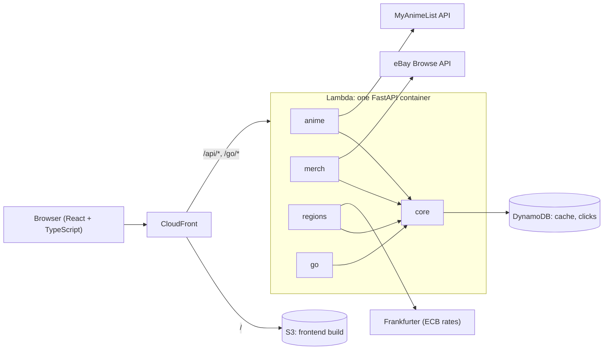

# OshiLoot

[](https://github.com/Runus01/oshiloot/actions/workflows/ci.yml)

Find official and second-hand merch for the anime on your MyAnimeList, ordered by the
scores you gave them.

**Live:** _add your CloudFront or custom-domain URL here after the first deploy_

- Enter a MyAnimeList username, or sign in with MyAnimeList if your list is private, and
  see Completed and Watching anime grouped by your score, 10 first.
- Open an anime to see live eBay listings plus search links for CDJapan, AmiAmi,
  HobbyLink Japan, Mercari (via Buyee) and Carousell, filtered to stores that ship to your
  country.
- Prices show in the original currency with an approximate local price; shipping is shown
  where the store's API provides it.
- Every outbound link goes through a signed `/go/` redirect that records the click
  (store, anime, country — nothing personal) and can carry affiliate tracking.

## Architecture

A modular monolith: one FastAPI app with four modules that never import each other, deployed
as one container on AWS Lambda behind CloudFront. Why this shape rather than microservices:
[ADR 0001](docs/adr/0001-modular-monolith.md). How sign-in works without storing anyone's
data on the server: [ADR 0002](docs/adr/0002-sign-in-session-in-cookie.md).



| Module | Routes | Owns |
| --- | --- | --- |
| `anime` | `/api/anime/*` | User lists (public, or private after MAL sign-in; never stored), search, details via an `AnimeSource` interface |
| `merch` | `/api/merch` | Store catalogue (`stores.yaml`), store adapters, parallel search with per-store deadlines, link signing |
| `regions` | `/api/regions/*` | Supported countries and currencies, daily exchange rates |
| `go` | `/go/{token}` | Verifies the signed link, records the click, redirects |
| `core` | — | Settings, cache and event log (memory or DynamoDB), shared HTTP client, signing, request logging |

Module boundaries are checked in CI by [import-linter](https://import-linter.readthedocs.io)
(contracts in `backend/pyproject.toml`).

**Costs.** Designed for AWS's always-free allowances: Lambda (1M requests a month),
DynamoDB in provisioned mode (25 read and 25 write units), and CloudFront's $0 flat-rate
plan. The only recurring charge is a few cents a month for container images in ECR.

## Repo layout

```text
backend/          FastAPI app (app/), tests, Dockerfile
  app/core/       shared building blocks
  app/anime/      MyAnimeList lists, search and sign-in
  app/merch/      stores.yaml, adapters/, fan-out service
  app/regions/    countries and exchange rates
  app/go/         click tracking redirect
frontend/         React + Vite + TypeScript
infra/            AWS CDK (TypeScript): OshiLootBase and OshiLootApp stacks
docs/adr/         design decisions
.github/          CI, deploy and Dependabot config
```

## Run it locally

You need Python 3.12, Node 22 and, for option B, Docker Desktop. Commands are for
PowerShell; on macOS or Linux, activate the virtual environment with
`source .venv/bin/activate` instead.

```powershell
Copy-Item .env.example .env      # then add your MAL_CLIENT_ID (optional for a first look)
```

**Option A — Python directly (fastest to iterate)**

```powershell
cd backend
py -3.12 -m venv .venv
.\.venv\Scripts\Activate.ps1     # if blocked: Set-ExecutionPolicy -Scope CurrentUser RemoteSigned
pip install -r requirements-dev.txt
uvicorn app.main:app --reload --port 8080
```

**Option B — the same container Lambda runs, with DynamoDB Local**

```powershell
docker compose up --build
```

Then, in a second terminal:

```powershell
cd frontend
npm install
npm run dev
```

Open http://localhost:5173. API docs are at http://localhost:8080/api/docs.

Without `MAL_CLIENT_ID`, loading a list shows a "not configured" message and search won't
work; the merch page still works with plain store links. Get a Client ID at
https://myanimelist.net/apiconfig (choose *non-commercial* while you build).

**To try "Sign in with MyAnimeList" locally,** set your MAL app's *App Redirect URL* to
`http://localhost:5173/api/anime/auth/callback` and add its Client Secret to `.env` as
`MAL_CLIENT_SECRET`, then restart the backend. The sign-in button appears once the secret is
set. Use the Vite address (port 5173), not 8080: the dev server forwards `/api` to the
backend, so the page and the sign-in cookie share one origin, as they do behind CloudFront.

**About the container images:** the Python base comes from Google's mirror of Docker Hub,
which needs no sign-in. The Lambda Web Adapter is published only on Amazon ECR Public, which
caps anonymous pulls and often refuses busy networks with `429 ... Data limit exceeded`. So
Docker Compose and CI build the `app` stage of the Dockerfile, which leaves the adapter out
(it does nothing outside Lambda), and only the deploy workflow builds the full image, after
signing in to ECR Public. To build the full image yourself, sign in first with any AWS
credentials:

```powershell
aws ecr-public get-login-password --region us-east-1 | docker login --username AWS --password-stdin public.ecr.aws
docker build --provenance=false -t oshiloot-backend backend
```

## Tests and checks

```powershell
# in backend/ (with the virtual environment active)
ruff check . ; ruff format --check . ; lint-imports ; pytest

# in frontend/
npm run typecheck ; npm test ; npm run build

# in infra/
npm install ; npm run typecheck ; npx cdk synth --quiet -c githubRepo=me/test
```

CI runs all of these on every pull request.

## Put it on GitHub

1. **Set your Git identity** (once per computer):

   ```powershell
   git config --global user.name "Your Name"
   git config --global user.email "you@example.com"
   ```

   To keep your email private, use the `...@users.noreply.github.com` address from
   GitHub → Settings → Emails.

2. **Make the first commit** from the repo folder:

   ```powershell
   git init -b main
   git add .
   git commit -m "feat: starter repo"
   ```

3. **Create the GitHub repo and connect it**, either with the GitHub CLI:

   ```powershell
   winget install GitHub.cli
   gh auth login
   gh repo create oshiloot --public --source . --remote origin --push
   ```

   or on the website: create a new **empty** repo at https://github.com/new (no README,
   .gitignore or license — those already exist here), then:

   ```powershell
   git remote add origin https://github.com/YOUR_GITHUB_USERNAME/oshiloot.git
   git push -u origin main
   ```

4. **Check the connection:** `git remote -v` shows `origin`, and the repo's Actions tab
   shows `ci` running. `deploy` is skipped until AWS is set up.

5. **Personalise:** replace `YOUR_NAME` in `LICENSE` and `YOUR_GITHUB_USERNAME` in this
   README and `infra/cdk.json`, then commit and push.

6. **Protect `main`:** Settings → Rules → Rulesets → New branch ruleset → target the
   default branch → require a pull request and the status checks `backend`, `frontend` and
   `infra`. Under Settings → Code security, turn on secret scanning push protection.

**Day to day:**

```powershell
git switch -c feat/country-picker     # one branch per change
git add . ; git commit -m "feat: remember chosen country"
git push -u origin feat/country-picker
gh pr create --fill                   # or open the PR on github.com
# after CI passes and you merge:
git switch main ; git pull
```

## Deploy to AWS

Do this once; afterwards every merge to `main` deploys itself.

1. **AWS account and CLI.** Create a personal AWS account (the Paid plan keeps the site up
   after six months and still gets sign-up credits), turn on MFA, add a $1 budget alert,
   and sign in with `aws configure sso`. Set the profile and region for this terminal:

   ```powershell
   $env:AWS_PROFILE = "your-profile"
   $env:AWS_REGION  = "us-west-2"
   ```

2. **Bootstrap CDK and deploy the base stack** (ECR repo plus the role GitHub Actions uses):

   ```powershell
   cd infra
   npm install
   npx cdk bootstrap
   npx cdk deploy OshiLootBase -c githubRepo=YOUR_GITHUB_USERNAME/oshiloot
   ```

   Copy the `DeployRoleArn` output. If your account already has a GitHub OIDC provider, add
   `-c createGithubOidcProvider=false`.

3. **Store secrets in SSM Parameter Store** (the Lambda reads everything under `/oshiloot/`):

   ```powershell
   $key = python -c "import secrets; print(secrets.token_urlsafe(32))"
   aws ssm put-parameter --name /oshiloot/link_signing_key --type SecureString --value $key
   aws ssm put-parameter --name /oshiloot/mal_client_id --type SecureString --value "YOUR_MAL_CLIENT_ID"
   # for "Sign in with MyAnimeList" (step 7 finishes it):
   aws ssm put-parameter --name /oshiloot/mal_client_secret --type SecureString --value "YOUR_MAL_CLIENT_SECRET"
   $sessionKey = python -c "import secrets; print(secrets.token_urlsafe(32))"
   aws ssm put-parameter --name /oshiloot/session_secret --type SecureString --value $sessionKey
   # optional, once you have them:
   aws ssm put-parameter --name /oshiloot/ebay_client_id --type SecureString --value "..."
   aws ssm put-parameter --name /oshiloot/ebay_client_secret --type SecureString --value "..."
   aws ssm put-parameter --name /oshiloot/ebay_campaign_id --type SecureString --value "..."
   ```

4. **Tell GitHub about AWS.** In the repo: Settings → Secrets and variables → Actions →
   Variables → add `AWS_DEPLOY_ROLE_ARN` (from step 2) and `AWS_REGION` (e.g. `us-west-2`).
   These are variables, not secrets: there are no AWS keys anywhere in GitHub.

5. **Deploy.** Actions → deploy → Run workflow (or push to `main`). The run builds and
   pushes the image, deploys `OshiLootApp`, uploads the frontend and smoke-tests
   `/api/healthz`. The site URL is in the run summary.

6. **Switch CloudFront to the free flat-rate plan.** CloudFront console → your
   distribution → pricing plan → Free. CDK can't set pricing plans yet, so this is the one
   manual step.

7. **Turn on "Sign in with MyAnimeList".** Sign-in needs the site's public address, which
   exists only after the first deploy:

   ```powershell
   aws ssm put-parameter --name /oshiloot/public_url --type String --value "https://YOUR-SITE.cloudfront.net"
   ```

   Then set the App Redirect URL of the MAL app whose ID is in SSM to
   `https://YOUR-SITE.cloudfront.net/api/anime/auth/callback`. A separate MAL app for
   production keeps `localhost` sign-in working for development. The backend reads SSM when
   a Lambda instance starts, so the change applies from the next deploy. Until all three
   sign-in parameters are set, the sign-in button stays hidden.

To remove everything: `npx cdk destroy OshiLootApp OshiLootBase` (the clicks table is kept on
purpose; delete it in the DynamoDB console if you don't need it).

## Configuration

| Variable | Used for |
| --- | --- |
| `MAL_CLIENT_ID` | MyAnimeList API (lists, search, details) |
| `MAL_CLIENT_SECRET` | Sign in with MyAnimeList; without it the sign-in button is hidden |
| `PUBLIC_URL` | The site's address; MAL redirects back to `PUBLIC_URL/api/anime/auth/callback` |
| `SESSION_SECRET` | Encrypts the sign-in cookie; required in AWS for sign-in |
| `EBAY_CLIENT_ID`, `EBAY_CLIENT_SECRET` | eBay Browse API; without them eBay is a plain search link |
| `EBAY_ENV` | `production` or `sandbox` |
| `EBAY_CAMPAIGN_ID` | eBay Partner Network commission tracking |
| `CDJAPAN_AFFILIATE_TEMPLATE` | CDJapan affiliate link pattern with `{path}` or `{url}` |
| `LINK_SIGNING_KEY` | Signs `/go/` links; required in AWS |
| `STORAGE` | `memory` (default) or `dynamodb` |

In AWS, each of these is read from SSM as `/oshiloot/<lowercase name>`.

## Adding a store

1. Add it to `backend/app/merch/stores.yaml`. A link-out store needs only a search URL
   template; check the template by searching on the site and comparing the address bar.
2. If the store has a search API, add an adapter in `backend/app/merch/adapters/` that
   returns `Offer` objects, register it in `merch/router.py`, and add a test with `respx`.

## Data, terms and disclosure

- **MyAnimeList:** the [API agreement](https://myanimelist.net/static/apiagreement.html)
  requires MAL's written approval before an app that uses it earns revenue, and bars storing
  users' list data on the server. Lists are passed through and kept only in the browser's
  session storage; request logs record route templates, not usernames. Ask MAL for approval
  before turning on affiliate links.
- **Signing in** uses MAL's OAuth flow with PKCE. The MAL tokens never touch a database:
  they live in an encrypted, HttpOnly cookie in the user's browser (scoped to `/api/anime`,
  31 days), so the backend stays stateless. Signing out deletes the cookie.
- **Affiliate links** are disclosed in the site footer. Keep that sentence if you change
  the layout.
- **Search URL templates** in `stores.yaml` were written by hand; only the Carousell
  Singapore pattern has been checked against a live example.

## Roadmap

- [ ] Rakuten Ichiba adapter (official API with affiliate links)
- [ ] AniList as a second `AnimeSource`
- [x] Sign in with MyAnimeList (OAuth with PKCE) for private lists
- [ ] Load test and p95 latency numbers in this README
- [ ] Custom domain
